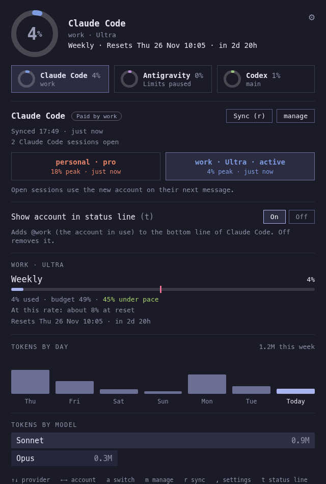

# Swapkin

Switch between several accounts, for several tools, from the Omarchy bar,
without re-logging in and without losing your sessions.

Swapkin now covers Claude Code, Codex CLI, Copilot CLI (via `gh`) and Antigravity (`agy`, shown only: it keeps one sign-in). Each
provider switches its own way — some pick up the new account on their very
next message, others only for a session you start after the switch — see
[How switching works](#how-switching-works) below.

One shared config directory stays where it is. A switch swaps the login inside
it, so settings, sessions, skills, hooks and MCP logins are untouched.



## What it does

- **A wide popover with two columns.** Providers on the left, the one you picked
  on the right, and a "next message is paid by" strip on top. On a screen tall
  enough it never scrolls; on a shorter one the columns scroll inside it.
- **Switch accounts from the bar.** Every account is a card. Move over one to
  preview its limits, then switch. Keys: `↑` `↓` provider, `←` `→` account,
  `a` switch, `m` manage (inside it: `u` use, `n` rename, `c` colour, `f` forget, `v` save the current login), `,` settings (`↑ ↓ ← →` change a row, `w` weekly pace, `o` models), `r` sync (fresh usage for every saved account).
- **Each account keeps its own colour**, shown in the bar icon, the account list
  and, if you want it, the Claude Code status line.
- **Limits for every account**, not only the active one: session window, weekly
  window and any model-specific window the plan has.
- **Pace, not just a percentage.** `13% used · budget 20% · 7% under pace`,
  `At this rate: about 64% at reset`, and the reset time. The budget grows only
  during the days and hours you work (see below).
- **A watchdog while the panel is closed.** It warns once when the active
  account passes your threshold. Hand-over when an account is spent is opt-in.
- **Today's tokens at API prices**, as an estimate you can sanity-check.

## Requirements

- Omarchy with the shell plugin system (`omarchy plugin --help` works)
- `jq` and `notify-send` for the warnings
- Whichever tools you actually switch: `claude` (Claude Code), `codex`
  (Codex CLI), `gh` with the Copilot CLI extension, or your own

## Install

```bash
omarchy plugin add https://github.com/sirallap/omarchy-swapkin --enable
```

The widget replaces Omarchy's built-in Agents widget in the bar. To go back:

```bash
omarchy plugin remove io.github.sirallap.swapkin
```

The plugin does not put `swapkin` on your PATH. From the plugin folder run:

```bash
bin/swapkin install-cli
```

This links `~/.local/bin/swapkin` to the plugin's script. It replaces an old
symlink and never a real file, and it is safe to run again.

## First run

Open the panel, press **manage**, then **+ add account**.

The first account is whoever is signed in right now — nothing to type. Every
account after that opens Claude Code in a throwaway config folder; run `/login`
and Swapkin saves the account and closes the window by itself. Your usual config
is never touched by that sign-in.

From a terminal, the same thing:

```bash
swapkin add work        # or just: swapkin add
swapkin use personal
swapkin list
```

## How switching works

Pick a provider with `swapkin -p <id> ...` (`claude` if you leave it out).
Each one switches a different way:

- **Claude Code — next message.** Claude Code keeps its login in
  `.credentials.json` and the account profile in `.claude.json`. Swapkin swaps
  only the account's own keys there and re-reads the file when its
  modification time changes, so a running session picks the new account up on
  its next request. Connectors may keep the old account until that session is
  restarted.

  | Swapped with the account | Left alone |
  | --- | --- |
  | `claudeAiOauth` in `.credentials.json` | `mcpOAuth` (Slack, Figma, …) |
  | The account keys in `.claude.json`: profile, user id, model access, org defaults, extra-usage state | Projects, history, onboarding, machine ids, settings, skills, hooks |

- **Codex CLI — new sessions.** Codex reads its login from `$CODEX_HOME`, so
  `swapkin use` only moves a pointer to which account's home a *new* `codex`
  process gets. A Codex session already running keeps whatever it started
  with. See [below](#codex-and-other-new-session-tools) for how to point a
  shell or a launch at the current account.
- **Copilot CLI — new sessions.** Copilot has no login file of its own; it
  rides on `gh`'s account. Switching runs `gh auth switch`, so new Copilot CLI
  sessions (and anything else that asks `gh` who's signed in, including `git
  push`) use the new account, but a Copilot CLI session already running keeps
  its token. A login made with `copilot login` directly, instead of through
  `gh`, isn't switched by Swapkin.

Every provider writes the outgoing account's live login back to its own saved
copy *before* swapping in, so a stored login is never the stale half of a
refresh-token rotation.

## Codex and other new-session tools

`swapkin use` alone won't change a Codex (or Copilot CLI) session that's
already open — it only changes what the *next* one gets. Two ways to make
that automatic:

```bash
eval "$(swapkin env)"      # add to your shell rc; sets CODEX_HOME etc. per shell
swapkin run codex           # or launch straight into the active account
```

`swapkin env [id]` prints the active account's environment as `export`
lines (no id switches every provider it knows); `swapkin run <id> [-- args]`
runs that provider's own CLI with the same environment already set.

## Your own tools

Any tool that reads its home directory from an environment variable can be
added without touching Swapkin's code. Describe it in
`~/.config/swapkin/providers.json`:

```json
{
  "providers": [
    { "id": "acme-cli", "name": "Acme CLI", "command": "acme", "mode": "cold",
      "homeEnv": "ACME_HOME", "defaultHome": "~/.acme", "loginCommand": "acme login" },

    { "id": "widget-agent", "name": "Widget Agent", "command": "widget", "mode": "cold",
      "homeEnv": "WIDGET_HOME", "defaultHome": "~/.widget" }
  ]
}
```

Both are **cold**: a separate home directory per account, so only an `acme`
or `widget` process started after `swapkin use` gets the new one. `acme-cli`
also names a `loginCommand`, which `add` runs with `ACME_HOME` pointed at the
new account's home so you can sign in.

Custom providers are cold-only. **Hot** mode — one shared login file swapped
in place, so a running session sees the new account on its next message — is
built in for Claude Code only: it overwrites a login file at a path the
config names, and that write could not be made safe against a symlink swap
in bash. A custom entry with `"mode": "hot"` or `loginFiles` is ignored with
a warning. Full contract (safety rules, `usageCommand`, sign-in flow) in
[`docs/providers.md`](docs/providers.md).

## Demo mode

`swapkin demo on` shows the panel filled with invented accounts and numbers
instead of your real ones — handy for a screenshot. `swapkin demo off` turns
it back off. Nothing it does ever reads or writes a real login.

## Commands

| Command | What it does |
| --- | --- |
| `swapkin status` | The active account and its plan |
| `swapkin list [--json]` | Saved accounts; `*` marks the active one |
| `swapkin add [name]` | Save a new account (the first is your current login) |
| `swapkin use <name>` | Switch every Claude Code session to that account |
| `swapkin colour <name> <#rrggbb>` | Set the colour that marks an account |
| `swapkin remove <name>` | Forget a saved account |
| `swapkin usage` | Refresh each account's limits |
| `swapkin check` | One watchdog pass: refresh, warn, auto-switch if on |
| `swapkin cost` | Today's tokens priced at API rates, as JSON |
| `swapkin statusline [--plain]` | The active account, coloured, for a status line |
| `swapkin statusline on\|off\|status` | Show or hide it in Claude Code's status line |

## Settings

Behaviour lives in `~/.local/share/swapkin/config.json`:

```json
{ "alertAt": 90 }
```

- `alertAt` — the weekly percentage that triggers one desktop warning per window.

### Auto-switch

Off by default. Turn it on and, when the active account has `autoSwitchLeftPct`
percent or less left on **any** limit (the 5-hour session, the weekly, or a
per-model weekly such as Fable), Swapkin switches to the roomiest other account,
exactly as if you had pressed `a` in the panel. Open sessions follow on their
next message. Wording in the panel: "Switch automatically when an account has 5% left".

- `autoSwitch` — `true` to enable (default `false`).
- `autoSwitchLeftPct` — 1 to 30, default 5.
- `autoSwitchReturn` — default `false`. A switch caused by the session limit does
  not undo itself when the session resets. With this on, once the account you left
  has more than the threshold left on every limit and is roomier than the current
  one, Swapkin switches back, at most once per switch.

They are widget settings (`omarchy bar set io.github.sirallap.swapkin autoSwitch true --json`)
and also live in the manage screen under AUTO-SWITCH (key `s`); `config.json` is
still read when a setting was never set from the bar.

The rules, so it never surprises you:

- The target needs a real login, figures from the last 2 hours, and more than the
  threshold left on every limit. Otherwise nothing switches and you get one
  "No other account has room" notification per window.
- One switch per account and limit window. The account you left is not a target
  until the limit that ran out resets, so two accounts never ping-pong.
- Stale or unreadable figures mean it does nothing. It takes the same lock as
  `swapkin use`, so it waits for a switch in progress.
- Each decision is logged to `~/.local/state/swapkin/autoswitch.log` (last 200 lines).
- Claude only, like `swapkin check`. Codex and other cold providers need a new
  sign-in to switch, so they are never switched automatically.

The watchdog interval and the weekly budget are widget settings:

```bash
omarchy bar set io.github.sirallap.swapkin watchIntervalMin 5 --json
```

`budgetSpread` (`Working days` or `Every day`), `budgetDays` (`Mon,Tue,Wed,Thu,Fri`),
`budgetStartHour` (9) and `budgetEndHour` (19) shape the pace curve: only those
hours earn weekly budget. With no working day picked, or an end hour that is not
after the start, the budget grows evenly all week.
The manage screen has a Weekly pace block for the same four settings: Working
hours or Every hour, the day chips, and the start and end hour (key `w`).
A Models shown block (key `o`) has one chip per model seen, with its token total:
click, or arrow keys and enter, to hide an old model from Tokens by model. It
only changes the list; no usage is deleted. `Show all` clears it, and a model
that appears later is shown. It is the `modelsHidden` setting (comma-separated
model ids, empty by default).

`prices.json`, next to the plugin, holds the per-million-token rates used for the
"at API prices" line. They change; edit the file rather than the code.

## Where things live

```
~/.local/share/swapkin/
  active                  the account in use
  config.json             alertAt (older setups: autoSwitch*)
  <account>/oauth.json    that account's login        (0600)
  <account>/account.json  its profile keys            (0600)
  <account>/meta.json     its colour
  <account>/usage.json    its last good limits
```

Logins are readable only by you. They never leave the machine: Swapkin talks to
the same Anthropic usage endpoint Claude Code already uses, one account at a
time, from that account's own saved login.

## Status line

Swapkin can put the active account, in its colour, in Claude Code's status line.
Use the panel row "Show account in status line" (On/Off, key `t`), or:

```bash
swapkin statusline on      # show it
swapkin statusline off     # hide it
swapkin statusline status  # on or off
```

Off is a Swapkin setting that `swapkin statusline` itself obeys: it prints
nothing. So Off works however you wired it, even by hand in your own script.
On wires `settings.json` only when nothing calls `swapkin statusline` yet:

- No status line yet: it sets one that runs `swapkin statusline`.
- You already have one that does not call it: it is never replaced. `statusLine`
  points at a small script in Swapkin's data dir that runs your original command,
  then prints the account on the next line. Off puts your setting back as it was.
- Your script already calls `swapkin statusline`: nothing is rewired.

Wiring edits `~/.claude/settings.json` (or `$CLAUDE_CONFIG_DIR/settings.json`)
with `jq`, through a temp file and a rename, after copying it to
`settings.json.swapkin-bak`. Running it twice changes nothing. `install` and
`uninstall` do only the wiring. The row shows only for providers that support
it (Claude today).

The segment itself, for your own script:

```bash
swapkin statusline            # coloured, for a terminal
swapkin statusline --plain    # just @work
printf '\n'; swapkin statusline
```

A line of its own survives a narrow or split pane, where a long first line is
cut off.

### Codex

Codex has no custom status line: `[tui].status_line` and `[tui].terminal_title`
take only built-in items, never a command. Put the account in the terminal
title instead, with a wrapper in your shell rc:

```bash
codex() { printf '\033]0;codex %s\007' "$(swapkin -p codex statusline --plain)"; command codex "$@"; }
```

Codex may rewrite the title once it starts. To keep ours, set this in
`~/.codex/config.toml`:

```toml
[tui]
terminal_title = []
```

## Limitations

- Claude Code, Codex CLI, Copilot CLI and Antigravity ship built in; anything else with the
  same shape of login is a `providers.json` entry away.
- Token history is machine-wide, not per account — the session files do not
  record which account paid for them. Limits *are* per account.
- An idle account's figures are only as fresh as its login: when its token
  expires, the panel keeps the last good numbers and says how old they are.
- Switching touches undocumented internals of Claude Code's config. It has
  worked since day one here, but a future release could move things.

## Licence

MIT. Parts of the panel are derived from Omarchy's built-in agents plugin,
also MIT. Claude and Claude Code are trademarks of Anthropic; this is an
independent project and is not affiliated with or endorsed by Anthropic.
